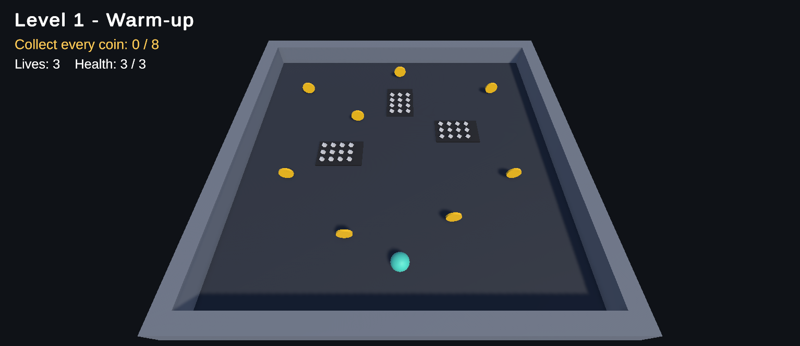
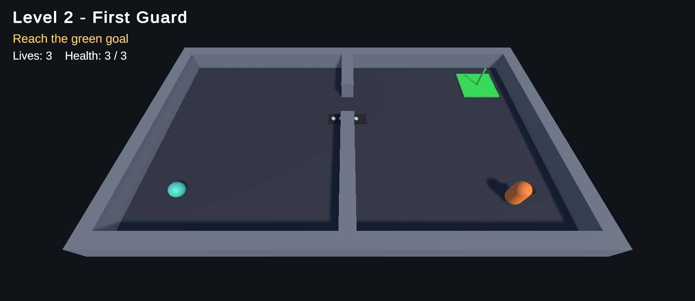
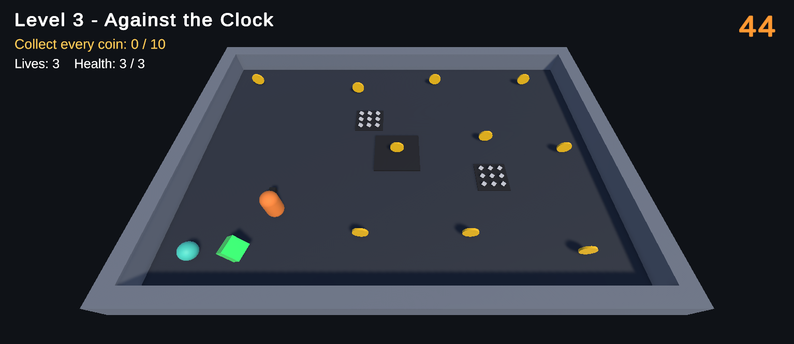
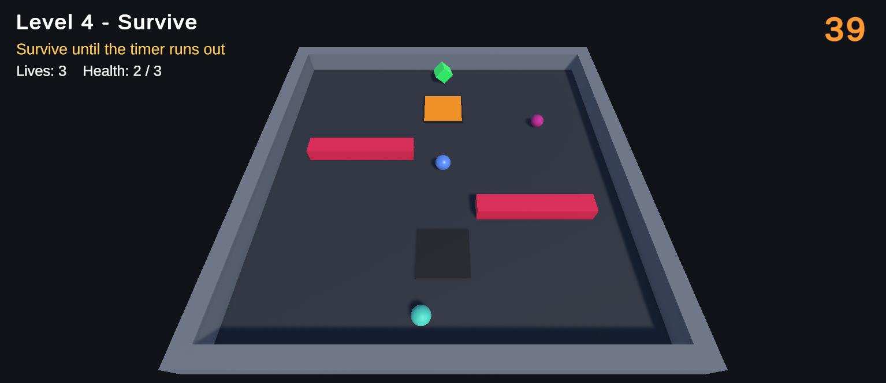
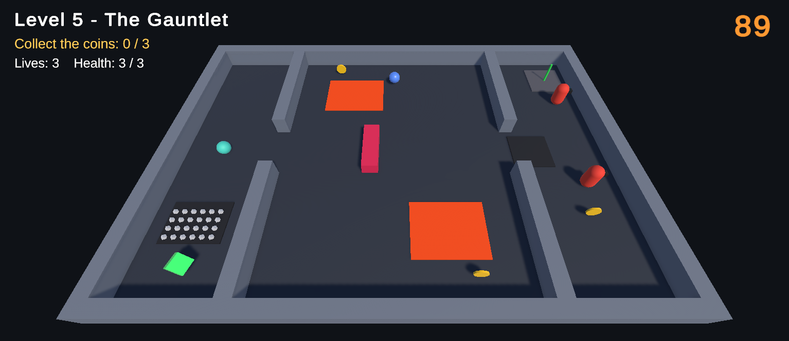

# ITU-CS-464-LAB-06-BSSE23040

CS-464 Game Development, Lab 06. I rebuilt the arena game from Lecture 07 (enemies, obstacles and power-ups) and then stretched it into a game with 5 levels. Every level has its own layout and its own objective, and each one is harder than the one before.

Unity 6000.6.2f1 (URP), C#. Roll number: BSSE23040.

## How to play

Open `Assets/Scenes/Level01_WarmUp.unity` and press Play. The five levels are in the build settings in order, so the **Next Level** button on the win panel takes you through the whole game, and after Level 5 you can play again.

Move the ball with `W A S D` or the arrow keys. You have 3 lives with 3 hearts each. If your lives run out, or the timer does, you can restart the level from the lose panel.

## The 5 levels

| | Level | Objective | What is in it |
|---|---|---|---|
| 1 | Warm-up | Collect all 8 coins | An open room and 3 spike patches. No enemies, no timer. |
| 2 | First Guard | Reach the green goal | Two rooms with a door between them, spikes in the doorway and a guard that patrols the second room. |
| 3 | Against the Clock | Collect 10 coins in 45 seconds | A crusher with a coin on it, a guard that walks back and forth, spikes and a speed power-up. |
| 4 | Survive | Stay alive for 45 seconds | Two sweepers, two crushers, a shield and a speed power-up, and waves of chasers that get bigger. |
| 5 | The Gauntlet | Collect 3 coins, then reach the exit in 90 seconds | Lava pools, a sweeper, a crusher on a door, guards that patrol, chase and go back, spikes and both power-ups. |

The difficulty goes up in a few ways: more kinds of danger in each level, faster and smarter enemies, tighter timers, and a bigger objective (collect, then reach, then beat the clock, then survive, then everything at once).







## The scripts

These are the ones from the lecture, plus a few that the levels needed.

| Script | What it does |
|---|---|
| `PlayerController` | Reads the keys in `Update`, pushes the ball with `AddForce` in `FixedUpdate`. `BoostSpeed` runs the speed power-up as a coroutine on the player. |
| `Health` | The hearts. It gives 1 second of i-frames after a hit, so standing on spikes costs one heart a second and not fifty. It dies at `<= 0` because the crusher hits for 2. |
| `GameManager` | One per level. Keeps the score, lives, timer and objective, respawns the player, shows the win and lose panels, and loads the next level. |
| `Hazard` | A trigger that hurts and knocks the ball back with one impulse. With a rest time it becomes a crusher: rest, warn for 0.7 s, then strike. |
| `EnemyPatrol` | Walks a list of waypoints. Loop, PingPong or Random. |
| `EnemyGuard` | A small state machine on top of the patrol: Patrol, Chase when it sees the ball, Return when it loses it. Seeing uses range, field of view and a raycast, so walls block it. |
| `MovingHazard` | A sweeper that slides back and forth on a steady rhythm. |
| `KillZone` | Lava. It skips the hearts and takes a life at once. |
| `PowerUp` | A speed boost for 5 seconds, or a shield that absorbs one hit. |
| `Coin`, `Goal` | A coin reports to the GameManager. The goal stays grey until the objective lets it open. |
| `Chaser`, `WaveSpawner` | Small enemies that walk at the ball and give up after 12 seconds, sent in waves of 2, 3, 4 and so on. |

## Things I decided

- **Each level has its own GameManager settings.** The objective (collect coins, reach the goal, collect then reach the goal, or survive), the coin target and the time limit are set in the Inspector, so one script handles all 5 levels.
- **Running out of time is a loss in every level except Level 4,** where the timer is the goal and reaching zero wins.
- **Guards are slower than the ball**, so they can always be outrun. Chasers are slower than the guards.
- **A respawn waits 0.6 seconds** and then gives 1.5 seconds of protection, so the knockback from the hit that killed you does not slide the new ball away.
- The ball cannot jump, so there are no gaps to fall into. Lava pools are the danger on the floor instead.

## Folders

```
Assets/Scripts     all the scripts above
Assets/Prefabs     Player, Coin, Guard, ChaseGuard, Crusher, Sweeper, Chaser, SpeedPowerUp, ShieldPowerUp, Goal
Assets/Materials   one material per colour
Assets/Scenes      Level01_WarmUp ... Level05_TheGauntlet
Docs/screenshots   pictures used in this README
```

## Git

I worked on the `development` branch with one small commit per step: the project, each script, then one commit per level. It was merged into `main` with a pull request.
